

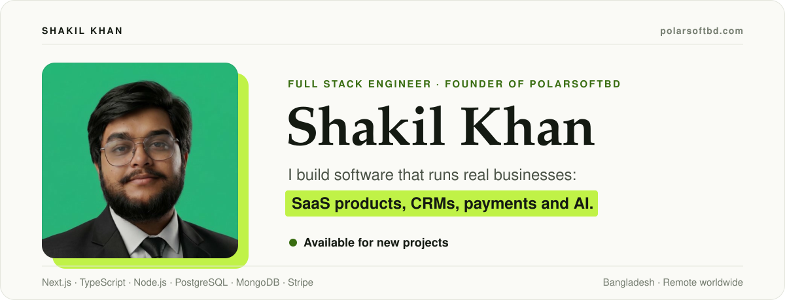

 

 

## About

I'm a full stack engineer who builds and runs the platforms businesses operate on: SaaS products, payment systems, automation and practical AI. I'm the Lead Developer at **Volare AI** on a remote contract, a **Level 2 seller with Fiverr's Choice** on Fiverr, and I publish ready-made software on CodeCanyon.

Most of my work is the part a business depends on every day: the CRM the team lives in, the payments that have to reconcile, the integrations that have to keep running. I start with how the business actually works, design the system around it, build it end to end, and stay with it after launch. I care about correct data, secure payments, clear UX, automated tests and documentation the next developer can follow.

 

## What I build

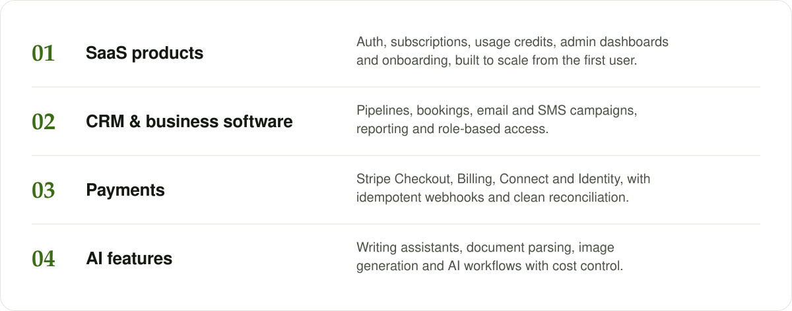

 

## Selected work

  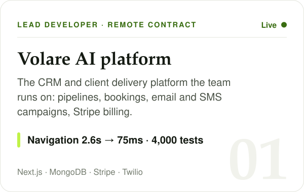
  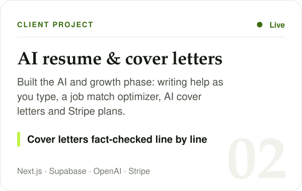
  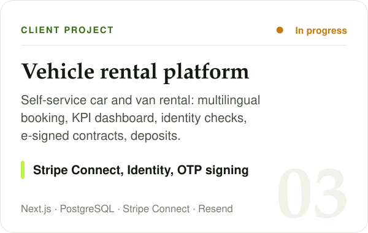
  <a href="https://clinicalcanvas.polarsoftbd.com">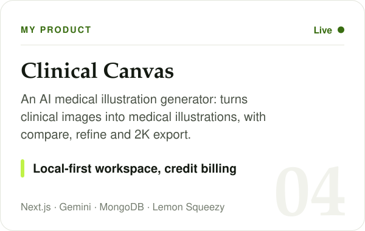</a>
  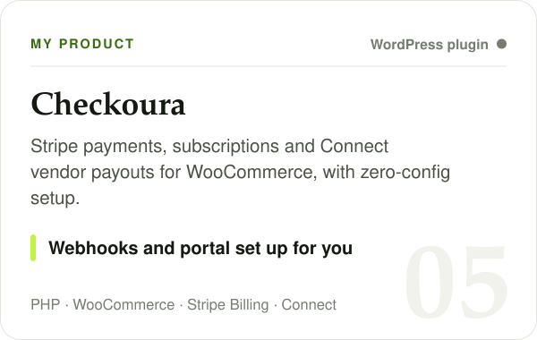
  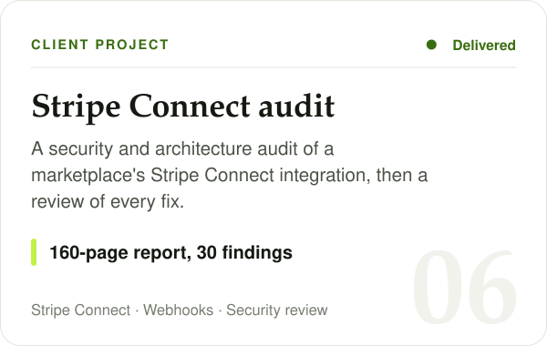
  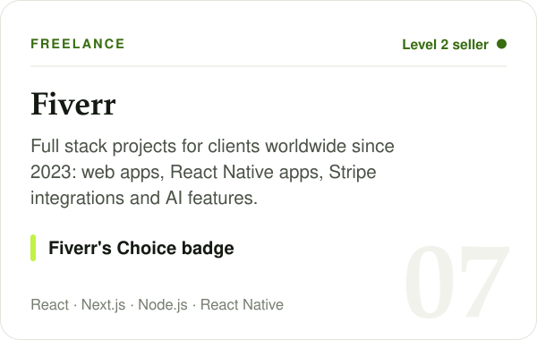
  <a href="https://linkedin.com/in/shakilkhan496">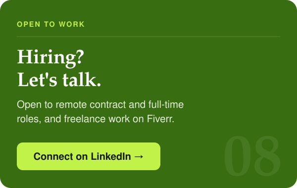</a>

<b>Read the full project notes</b>

 

**Volare AI platform** · Lead Developer, remote contract · live 
I build and run the platform Volare operates on: the CRM and client delivery system the whole team uses every day. Pipeline and deal management, booking routes synced to Google Calendar, email and SMS campaigns with consent handled properly, Stripe billing and subscriptions, Google Workspace and meeting transcript integration, reporting, and AI generated client roadmaps. Around 240 modules and 4,000 automated tests. Page navigation went from 2.6 seconds to 75 milliseconds by profiling where the time actually went, the company went from no outbound SMS to an approved A2P messaging setup, and non-technical staff now run their own campaigns.

**AI resume and cover letter SaaS** · client · live 
Engineered the AI and growth phase of a resume builder: AI writing help as you type, an AI job match optimizer, a five-step AI cover letter builder with a fact-checking pipeline, Stripe subscriptions, Word export, Trash and restore, Google sign-in, bot protection, branded email, and a guest mode that lets visitors try everything before signing up.

**Vehicle rental platform with digital contracts** · client · in progress 
A self-service car and van rental platform on top of a contract and payments engine: multilingual booking site, admin and KPI dashboard, identity verification, digital contracts with OTP e-signature, card deposits, check-in and check-out photos, and Stripe Connect payments.

**[Clinical Canvas](https://clinicalcanvas.polarsoftbd.com)** · my product · live 
An AI medical illustration generator that turns clinical images into medical and surgical illustrations, with side-by-side comparison, refinement and 2K export. Credit-based billing with atomic ledgers, and a local-first workspace: projects and images stay in the user's browser, while the server keeps only account and billing records.

**Checkoura** · my product 
A WooCommerce plugin for Stripe payments, subscriptions and Connect Express vendor payouts. Zero-config setup creates webhooks and the customer portal automatically, behind a Stripe-style admin dashboard.

**Stripe Connect marketplace audit** · client 
A security and architecture audit of a two-sided marketplace's Stripe Connect integration: a 160-page report with 30 findings, 5 of them critical, then a review of each fix and a test-mode validation plan.

**Fiverr** · freelance since 2023 
Level 2 seller with Fiverr's Choice. Full stack projects for clients worldwide: web apps, React Native mobile apps, Stripe integrations and AI features.

Most client work lives in private repositories. I'm happy to walk through the architecture and code on a call.

 

## How I work

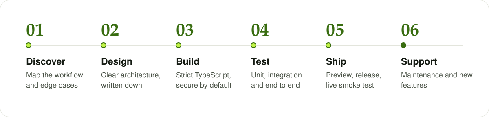

- **Business first.** I map the workflow and the edge cases before writing code, and put decisions in writing: scope, trade-offs and what done means.
- **Production-grade by default.** Strict TypeScript, server-side validation, row-level security, idempotent webhooks, rate limits and safe database migrations.
- **Measured, not guessed.** When something is slow, I profile where the time goes before reaching for a bigger server.
- **Clear communication.** Plain-language updates, visual delivery guides and documentation, so the team always knows what changed and why.

 

## Tech stack

 

 

<b>The full toolbox</b>

 

| Area | Tools |
|---|---|
| **Frontend** | React 19, Next.js 16 (App Router), TypeScript, Tailwind CSS, shadcn/ui, Framer Motion, Redux Toolkit, React Native (Expo) |
| **Backend** | Node.js, Next.js route handlers, Express, REST APIs, webhooks, scheduled jobs |
| **Data** | PostgreSQL (Supabase, Neon), Prisma, MongoDB (Mongoose, Atlas), row-level security |
| **Payments** | Stripe Checkout, Billing, Customer Portal, Connect and Identity, Lemon Squeezy |
| **AI** | OpenAI, Anthropic Claude, Google Gemini, Vercel AI SDK |
| **Integrations** | Google OAuth, Calendar and Drive, Microsoft APIs, Twilio, Resend, Cloudinary, Cloudflare Turnstile, Fathom |
| **Quality and delivery** | Vitest, Playwright, ESLint, GitHub Actions, Vercel, Linux VPS |

 

## Contributions

  <picture>
    <source media="(prefers-color-scheme: dark)" srcset="https://raw.githubusercontent.com/shakilkhan496/shakilkhan496/output/github-contribution-grid-snake-dark.svg"/>
    <source media="(prefers-color-scheme: light)" srcset="https://raw.githubusercontent.com/shakilkhan496/shakilkhan496/output/github-contribution-grid-snake.svg"/>
    
  </picture>

 

## Let's work together

I'm open to **remote contract and full-time roles**, and I take on freelance projects through **Fiverr**: SaaS builds, CRM and business software, Stripe integrations, AI features and long-term maintenance for existing products. If you're hiring or have a system that needs building, I'd be glad to hear about it.

