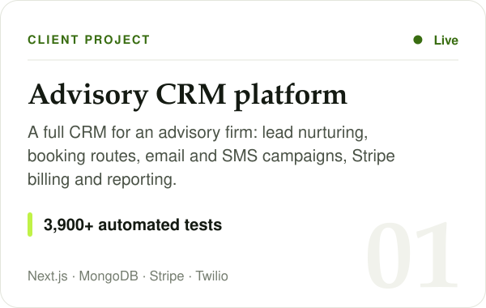
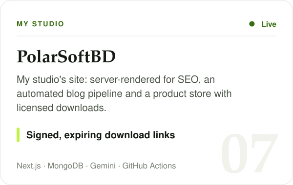

 

 

## About

I'm a full stack engineer and the founder of **[PolarSoftBD](https://polarsoftbd.com)**, a software studio that builds for founders and growing businesses worldwide. I start with the business problem: how the team works today, where time and money leak, and what success looks like. Then I design the system around it and build it end to end.

My work runs in production: CRMs that run a company's sales and bookings, SaaS products with real paying users, and payment flows that move real money. I care about the details that make software trustworthy: correct data, secure payments, clear UX, automated tests and documentation the next developer can follow.

 

## What I build

 

## Selected work

  
  
  
  
  
  
  
  

<b>Read the full project notes</b>

 

**Advisory CRM platform** · client · live 
A full CRM for an advisory and consulting company: contacts and lead nurturing, booking routes synced with Google Calendar, email and SMS campaigns, Stripe payments and subscriptions, meeting transcripts filed to Google Drive, reporting dashboards and role-based access. Delivered in reviewed stages with 3,900+ automated tests.

**AI resume and cover letter SaaS** · client · live 
Engineered the AI and growth phase of a resume builder: AI writing help as you type, an AI job match optimizer, a five-step AI cover letter builder with a fact-checking pipeline, Stripe subscriptions, Word export, Trash and restore, Google sign-in, bot protection, branded email, and a guest mode that lets visitors try everything before signing up.

**Vehicle rental platform with digital contracts** · client · in progress 
A self-service car and van rental platform on top of a contract and payments engine: multilingual booking site, admin and KPI dashboard, identity verification, digital contracts with OTP e-signature, card deposits, check-in and check-out photos, and Stripe Connect payments.

**[Clinical Canvas](https://clinicalcanvas.polarsoftbd.com)** · my product · live 
An AI medical illustration generator that turns clinical images into medical and surgical illustrations, with side-by-side comparison, refinement and 2K export. Credit-based billing with atomic ledgers, and a local-first workspace: projects and images stay in the user's browser, while the server keeps only account and billing records.

**Checkoura** · my product 
A WooCommerce plugin for Stripe payments, subscriptions and Connect Express vendor payouts. Zero-config setup creates webhooks and the customer portal automatically, behind a Stripe-style admin dashboard.

**Stripe Connect marketplace audit** · client 
A security and architecture audit of a two-sided marketplace's Stripe Connect integration: a 160-page report with 30 findings, 5 of them critical, then a review of each fix and a test-mode validation plan.

**[PolarSoftBD](https://polarsoftbd.com)** · my studio · live 
My studio's site: server-rendered for SEO, an automated publishing pipeline for the blog, and a digital product store with license keys and signed, expiring downloads.

Most client work lives in private repositories. I'm happy to walk through the architecture and code on a call.

 

## How I work

- **Business first.** I map the workflow and the edge cases before writing code, and put decisions in writing: scope, trade-offs and what done means.
- **Production-grade by default.** Strict TypeScript, server-side validation, row-level security, idempotent webhooks, rate limits and safe database migrations.
- **Clear communication.** Plain-language updates, visual delivery guides and documentation, so clients always know what changed and why.
- **Modern tooling, senior judgment.** I use AI coding tools to move faster, while architecture, code review and testing stay rigorous.

 

## Tech stack

 

 

<b>The full toolbox</b>

 

| Area | Tools |
|---|---|
| **Frontend** | React 19, Next.js 16 (App Router), TypeScript, Tailwind CSS, shadcn/ui, Framer Motion, Redux Toolkit, React Native (Expo) |
| **Backend** | Node.js, Next.js route handlers, Express, REST APIs, webhooks, scheduled jobs |
| **Data** | PostgreSQL (Supabase, Neon), Prisma, MongoDB (Mongoose, Atlas), row-level security |
| **Payments** | Stripe Checkout, Billing, Customer Portal, Connect and Identity, Lemon Squeezy |
| **AI** | OpenAI, Anthropic Claude, Google Gemini, Vercel AI SDK |
| **Integrations** | Google OAuth, Calendar and Drive, Twilio, Resend, Cloudinary, Cloudflare Turnstile, Fathom |
| **Quality and delivery** | Vitest, Playwright, ESLint, GitHub Actions, Vercel, Linux VPS |

 

## Contributions

  <picture>
    <source media="(prefers-color-scheme: dark)" srcset="https://raw.githubusercontent.com/shakilkhan496/shakilkhan496/output/github-contribution-grid-snake-dark.svg"/>
    <source media="(prefers-color-scheme: light)" srcset="https://raw.githubusercontent.com/shakilkhan496/shakilkhan496/output/github-contribution-grid-snake.svg"/>
    
  </picture>

 

## Let's work together

I take on SaaS builds, CRM and business software, Stripe integrations, AI features and long-term maintenance for existing products. If you have a product to build or a system that needs fixing, I'd be glad to hear about it.

